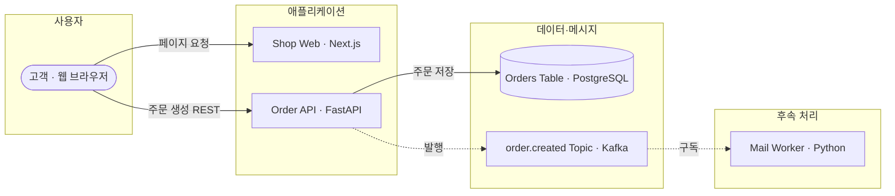
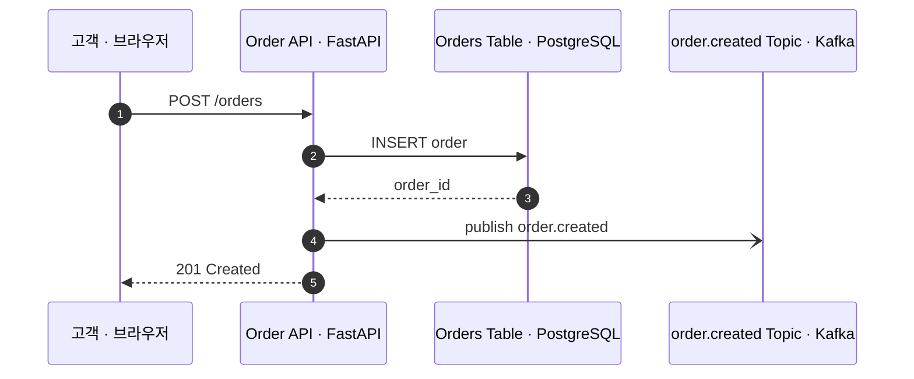
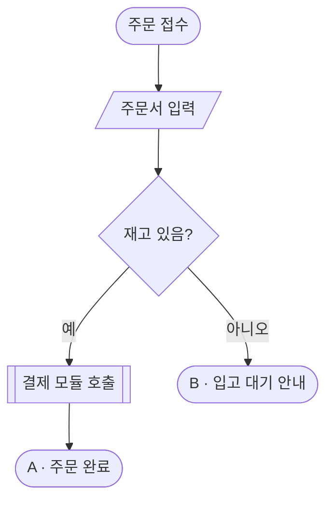

<!--
  예시 파일이다. 복사해서 docs/architecture/dashboard.md 로 두고 내용을 바꿔 쓴다.
  - 관점: "view: <종류> | <제목(선택)>" 절 + mermaid 블록 1개. 종류 = context·runtime·sequence·flow·deploy
  - 탭 이름은 차트 이름(시스템 아키텍처·플로우차트…)으로 자동. 관점 제목은 화면에 나오지 않는다(보조기술 설명용)
  - 설명 문단은 두지 않는다 — 그림이 말한다
  - "asis-tobe | <비교 제목>" 절: AS IS 소절에 지금 방식의 한계, TO BE 소절에 이점 (4줄·200자, 수치 없이). 화면 맨 위에 나온다
  - "compare | <표 제목>" 절: 지표 | AS IS | TO BE | 변화 표 + "출처:" 줄 — AS IS ▶ TO BE 바로 아래
  - 구조도: subgraph = 계층 칸(좌→우), 사람 ([ ]) · 앱 [ ] · 외부 [[ ]] · 저장소 [( )], 새 부분은 class … added
  - 흐름도: 끝 단말을 "A · …" 로 시작하고 그림 아래 "예시" 소절에 경로별 실제 사례
  - "jira | <제목>" 절: "- [KEY-123](https://<사이트>.atlassian.net/browse/KEY-123) 타이틀 — 유형" 목록. 화면 맨 아래
  - 규칙: references/diagram-rules.md (D1~D8), references/symbols.md (F1~F4·구조도 도형), references/layout.md (L1~L7)
-->

## asis-tobe | 알림 발송 구조 변경

### AS IS
주문 API가 메일을 직접 보낸다.
메일 서버가 느리거나 멈추면 주문 응답도 같이 느려지거나 실패한다.

### TO BE
주문 API는 주문 이벤트만 발행하고, Mail Worker가 구독해 따로 보낸다.
메일 장애가 주문에 번지지 않고, 알림 채널을 늘려도 주문 API는 그대로다.

## compare | 성능 비교

| 지표 | AS IS | TO BE | 변화 |
|---|---|---|---|
| 주문 API 응답 시간 (p95) | 1.8초 | 0.3초 | −83% |
| 메일 장애 시 주문 실패 | 있음 | 없음 | 해소 |

출처: (예시 값 — 실제 문서에는 측정 파일·기간·조건을 적는다)

## view: runtime | 주문이 저장되고 알림이 나가는 경로

## view: sequence | 주문 생성 요청과 응답이 오가는 순서

## view: flow | 재고에 따라 갈리는 주문 처리 흐름

### 예시
- **A** 재고가 있을 때 — "무선 이어폰 1개 주문" → 결제 모듈을 거쳐 주문 완료까지 간다.
- **B** 품절일 때 — "한정판 키보드 주문" → 결제 없이 입고 대기 안내로 끝난다.

## jira | 작업 Jira

- [SHOP-100](https://example.atlassian.net/browse/SHOP-100) 주문 알림 비동기 전환 — Initiative
- [SHOP-112](https://example.atlassian.net/browse/SHOP-112) Mail Worker 구독자 추가 — Story
